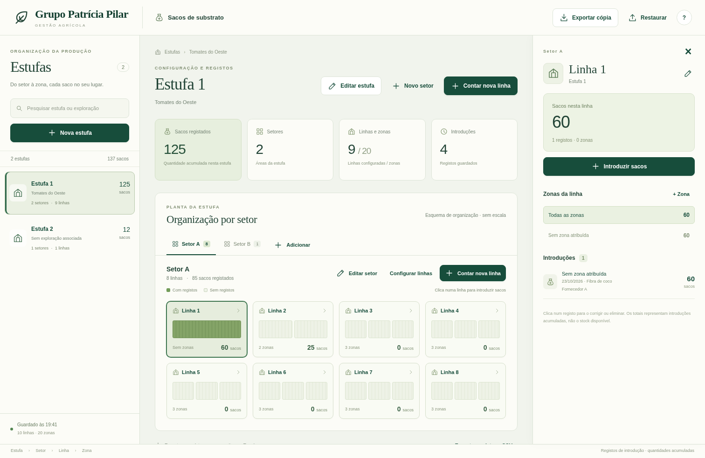
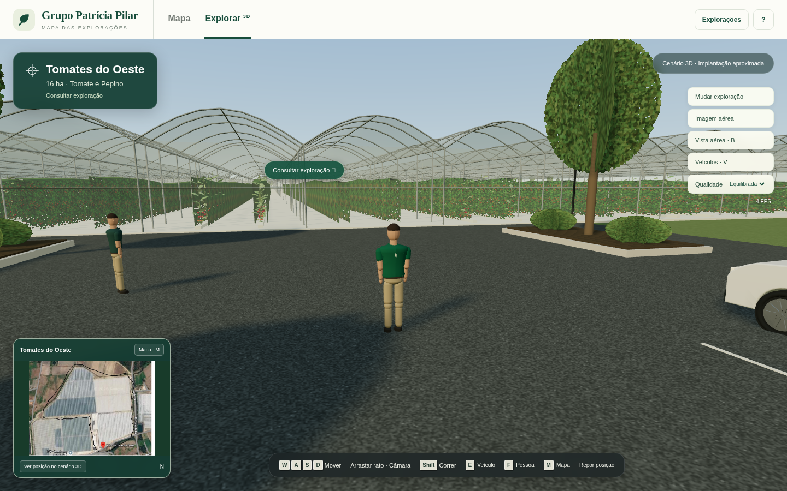

# Patrícia Pilar · Programas das estufas

## Novo programa · Sacos de substrato

**[Transferir Gestão de Sacos — ZIP](https://github.com/demoapps26/Emanuel/raw/refs/heads/main/downloads/Gestao_Sacos_Patricia_Pilar_v1.0.zip)**. Escolhe **Extrair tudo** e abre **SACOS.html**.

A estufa é construída durante a primeira contagem: cria a estufa, escolhe ou cria um setor, conta os sacos de uma linha ou de cada zona e usa **Guardar e próxima linha**. O programa cria a linha e as zonas com os dados introduzidos, sugere o próximo número e conserva a data, substrato, fornecedor e nomes de zonas para facilitar a continuação. As quantidades começam sempre vazias na linha seguinte.

Inclui edição de registos, totais por estufa/setor/linha/zona, configuração de linhas sem contagens, exportação para Excel em CSV e cópias JSON para recuperar toda a estrutura. Começa vazio; a demonstração opcional usa dados fictícios identificados.

Funciona sem Internet. **Os dados ficam no navegador; exporta uma cópia no fim de cada sessão.** Não há sincronização entre equipamentos. Os totais representam introduções acumuladas, não stock ou consumo.



Instruções, desenvolvimento e validação em [docs/SACOS.md](docs/SACOS.md).

## Mapa e visita em 3D

Explora as **13 explorações e a sede** com uma personagem em terceira pessoa e alterna para o mapa geográfico. A apresentação inclui a ficha do local, ponto de consulta no cenário, minimapa e fotografias aéreas originais. As localizações do mapa vêm dos links Maps fornecidos.



## Abrir o mapa

1. **[Transferir o mapa com visita em 3D — ZIP](https://github.com/demoapps26/Emanuel/raw/refs/heads/main/downloads/Mapa_Exploracoes_Patricia_Pilar_v1.1.zip)**.
2. Nas Transferências, clica com o botão direito no ZIP e escolhe **Extrair tudo**.
3. Abre **MAPA.html** no Chrome ou Edge.

O ficheiro MAPA.html contém a aplicação completa, os cenários, as fichas e as 14 fotografias aéreas. Abre na vista **Explorar 3D**. Precisas de um navegador com WebGL2 e aceleração gráfica recomendada; não precisas de instalar programas ou configurar uma chave Google. O ZIP inclui também as localizações em KML e GeoJSON.

## Visitar com a personagem

Em **Explorações / Mudar exploração**, escolhe o local. A personagem chega a um pátio de visita e podes andar à volta das estufas. **Consultar exploração** abre a mesma ficha disponível no mapa. As mudanças entre locais são viagens rápidas.

| Controlo | Ação |
| --- | --- |
| WASD / setas | Andar; ao volante, acelerar, virar, travar e recuar |
| Arrastar rato / roda | Rodar a câmara / aproximar e afastar |
| Shift | Correr |
| M / I | Mapa geográfico / informação da exploração |
| B / V | Vista aérea do cenário / escolher veículo |
| E / Espaço | Entrar ou sair depois de parar / travar |
| F / Esc | Consultar pessoa próxima / pausar |

No telemóvel há botões de direção. O minimapa alterna entre a **fotografia aérea fornecida** e a **planta aproximada com a posição da personagem**. A posição local só é desenhada nessa planta. Em Qualidade podes escolher Leve, Equilibrada ou Alta.

O Rafael aparece no **projeto das Deusas**, associado a equipamentos e apoio à construção. Foi retirado da descrição geral das outras explorações. Os nomes e relações usam uma identidade única por pessoa.

As estruturas, materiais, plantas, pátio de visita e personagem são modelos procedurais. A implantação e a escala local são aproximadas a partir das referências; o resultado continua estilizado e não iguala o realismo da imagem de conceito. As imagens aéreas originais permanecem disponíveis para comparação.

## Consultar uma exploração

- **Clica num ponto ou numa exploração da lista** para ver a ficha.
- **Pesquisa** pelo nome da exploração, cultura ou pessoa; os filtros permitem combinar cultura/tipo com a pessoa associada.
- **Oeste** aproxima os locais dessa região; **Todos os locais** inclui também a Lagoa Bondosa, em Alcochete.
- Usa a roda do rato ou os botões **+ / −** para ampliar o mapa e arrasta para o deslocar.
- Abre a **fotografia aérea** na ficha e amplia-a com os botões ou a roda do rato. Podes arrastar a fotografia para consultar pormenores.
- A ligação **Google Maps** de cada ficha abre o ponto original fornecido.
- **Explorar com personagem · 3D** abre o cenário da exploração escolhida.

As fichas distinguem explorações, construção e sede. As pessoas mantêm as suas associações: por exemplo, César é responsável da Framboesa 2 e apoia Lagoa, Várzea e Fenómeno. Responsáveis não identificados aparecem por confirmar.

## Fundos do mapa e utilização sem rede

**Satélite** usa imagens Esri; **Mapa** usa OpenStreetMap. Estes fundos precisam de Internet e mantêm a atribuição dos fornecedores. A cobertura e a data das imagens dependem da fonte; não são imagens em direto.

**Sem rede** apresenta os mesmos pontos sobre uma base vetorial Natural Earth incluída no ficheiro. Esta base dá contexto geográfico, mas não contém ruas ou pormenores das estufas. As fichas e as **14 fotografias fornecidas continuam disponíveis sem Internet**. Se o fundo online não carregar, o mapa mantém essa consulta disponível.

## Informação e precisão

Os pontos indicam as localizações dos links enviados, **não os limites dos terrenos ou de cada estufa individual**. As fotografias originais conservam as anotações e atribuições visíveis.

A informação inicial foi recolhida em **22/10/2026**. O catálogo declara **129,23 ha**, excluindo as Deusas. As **Deusas da Montanha têm 18 ha projetados e cerca de 4 ha quase concluídos**, apresentados separadamente da área declarada das outras explorações.

O link e a fotografia associados a **Ritual Frutado** têm a designação «Greenhouse Vale da Borra-GPP» na fonte. O mapa preserva a associação recebida e assinala esta diferença na ficha, sem fundir as duas identidades.

Se existirem edições descritivas guardadas pela versão anterior no mesmo navegador e origem, o mapa pode recuperá-las. As posições usam sempre os **pontos originais dos links**, mesmo que tenham sido editadas coordenadas na demonstração anterior. Este mapa permite consultar informação; não altera os dados guardados.

Os 21 ficheiros do pacote original permanecem em `materiais/Patricia_Pilar_Mundo_3D_Codex/`. As localizações estão em `dados/localizacoes_maps.json`. A base vetorial em `dados/mapa-contexto.geojson` deriva de [Natural Earth](https://www.naturalearthdata.com/), de domínio público. As fotografias são as referências fornecidas; as atribuições da fonte foram preservadas.

## Desenvolvimento

Requer Node.js 22.12+ e npm. As dependências estão fixadas no lockfile.

```bash
npm ci
npm run map:dev
```

Abre **http://localhost:5174/mapa-entry.html**.

```bash
npm run map:build
```

Gera o mesmo mapa autónomo em `MAPA.html`, `docs/mapa.html` e `release/Mapa_Exploracoes_Patricia_Pilar.html`. O código de desenvolvimento está em `src/map-app.js`, `src/map-model.js`, `src/map-details.js` e `src/map-app.css`; a entrada `mapa-entry.html` pertence ao desenvolvimento.

Para atualizar também o ZIP de entrega:

```bash
npm run map:package
```

O empacotamento do ZIP usa Python 3; isso só é necessário a quem prepara a entrega.

```bash
npm test
npm run test:map:browser
npm run test:explore:browser
```

O teste de navegador requer um servidor do mapa ativo e Chromium. Os resultados são registados depois da execução; não é necessário executar testes para usar MAPA.html.

Por omissão, os testes abrem `http://127.0.0.1:8090/MAPA.html`; o teste de consulta usa `?vista=mapa`. Podes servir a pasta do projeto com `python3 -m http.server 8090 --bind 127.0.0.1` noutro terminal ou indicar `TEST_MAP_BASE_URL` / `TEST_EXPLORE_URL`.

Os resultados e limites das verificações estão em [docs/MAPA_VALIDACAO.md](docs/MAPA_VALIDACAO.md).

Os ficheiros anteriores do jogo foram conservados. A documentação dessa versão está arquivada em [docs/JOGO_v0.4.md](docs/JOGO_v0.4.md). A entrada do projeto atual é **MAPA.html**.
