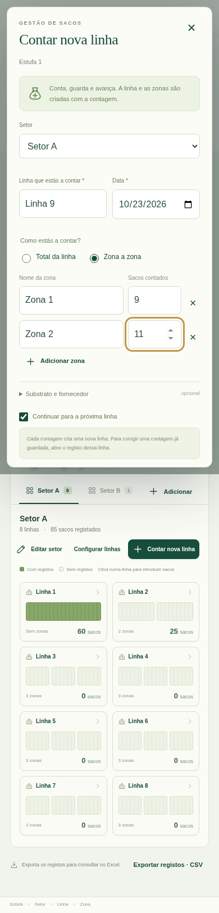

# Gestão de sacos de substrato · v1.0

Aplicação autónoma com a identidade visual do mapa: verde e creme, navegação lateral por estufa, indicadores e esquema interativo dos setores e linhas. **SACOS.html** é o programa para o utilizador; `sacos-entry.html` é a entrada de desenvolvimento.

[Transferir ZIP](https://github.com/demoapps26/Emanuel/raw/refs/heads/main/downloads/Gestao_Sacos_Patricia_Pilar_v1.0.zip). Extrai a pasta e abre **SACOS.html** no Chrome ou Edge.

## Construir a estufa enquanto contas

1. Cria uma estufa e indica a exploração. O programa abre **Contar nova linha**.
2. Escolhe um setor ou escreve o nome de um novo setor.
3. Confirma o nome sugerido para a linha e a data.
4. Conta o total da linha ou escolhe **Zona a zona** e acrescenta as zonas necessárias.
5. Guarda as quantidades, opcionalmente com tipo de substrato e fornecedor.
6. Com **Continuar para a próxima linha** ativo, o programa guarda e prepara a seguinte: sugere o próximo nome e mantém data, substrato, fornecedor e nomes de zonas. As quantidades ficam vazias.
7. Muda de setor quando necessário. Desmarca a continuação ou fecha a janela para terminar; as linhas guardadas mantêm-se.

O setor, a linha e as zonas são criados no mesmo passo da contagem. As zonas com zero sacos ficam configuradas, sem registo de introdução. Para guardar uma contagem nova, o total da linha deve ter pelo menos um saco. **Configurar linhas** permite criar linhas e zonas sem qualquer contagem.

As estufas podem usar o mesmo nome em explorações diferentes. Os nomes dos setores, linhas e zonas são únicos dentro do respetivo nível, ignorando maiúsculas, acentos e espaços exteriores.



## Consulta e correções

O esquema de organização não tem escala nem posição geográfica. Seleciona um setor e clica numa linha para ver as zonas e os registos. Filtra os registos por zona. Uma introdução registada na linha inteira fica em **Sem zona atribuída**; não é duplicada pelas zonas.

**Introduzir sacos** acrescenta uma nova introdução numa linha existente. Para corrigir uma contagem, abre o registo e edita-o; não acrescentes outro registo com a quantidade corrigida. Os totais são recalculados a partir dos registos e somam todas as introduções, sem descontar stock, saídas ou consumo.

Podes alterar os nomes e os metadados. Eliminar uma zona conserva os seus registos como **Sem zona atribuída** na mesma linha. Eliminar uma estufa, setor ou linha elimina os registos dependentes após confirmação. A aplicação apresenta os 100 registos mais recentes na linha selecionada; o CSV e o JSON incluem todos.

## Gravação e cópias

Os dados ficam no `localStorage` do navegador, com a chave própria `pp-gestao-sacos-v1`, independente do mapa. Cada gravação valida a hierarquia antes de a guardar. Uma falha de gravação mantém os dados anteriores e o formulário preenchido. Alterações noutra janela suspendem a gravação até recarregar; dados inválidos existentes são preservados para recuperação. Se o armazenamento estiver inacessível ao abrir, aparece um aviso de modo de sessão.

- **Exportar cópia** guarda toda a estrutura e os registos em JSON.
- **Restaurar** valida a cópia e pede confirmação antes de substituir os dados atuais. Não combina duas cópias.
- **Exportar registos · CSV** cria um ficheiro UTF-8 para Excel, separado por ponto e vírgula, com exploração, estufa, setor, linha, zona, data, quantidade, substrato, fornecedor e observações. Campos com fórmulas são neutralizados como texto. O CSV serve para consulta; a restauração usa o JSON.

Faz uma cópia no fim de cada sessão. Conserva o HTML na mesma pasta e usa o mesmo navegador. O armazenamento de ficheiros locais depende do navegador; trocar a pasta, limpar dados ou mudar de equipamento pode impedir o acesso ao armazenamento anterior. Não há servidor, autenticação ou sincronização entre equipamentos.

## Desenvolvimento e validação

```bash
npm ci
npm run sacos:dev
```

Abre `http://localhost:5175/sacos-entry.html`.

```bash
npm run sacos:package
npm test
python3 -m http.server 8091 --bind 127.0.0.1
```

Noutro terminal, `npm run test:sacos:browser`. Podes definir `TEST_SACOS_URL` e `CHROMIUM_PATH` para usar outro servidor ou navegador.

O build gera `SACOS.html`, `docs/sacos.html` e `release/Sacos_Patricia_Pilar.html` com JS e CSS incorporados. O ZIP inclui apenas `SACOS.html` e `LER_PRIMEIRO.txt`; não exige instalação ou dependências externas.

Em 23/10/2026 passaram **83 testes Node**, incluindo **14 testes do modelo de sacos**, e **23 verificações de navegador** no HTML autónomo, em Chromium, a 1512 × 982 e 390 × 844. A validação cobre criação durante a contagem, continuação por setor, zonas vazias, nomes repetidos, correções, eliminação, totais, isolamento entre estufas, gravação após recarregar, JSON e CSV descarregados, importação inválida/cancelada/confirmada, texto potencialmente malicioso, concorrência entre janelas, falha de gravação e recuperação de armazenamento inválido. Não houve erros JavaScript nem pedidos a serviços externos.

As capturas são da aplicação em execução com dados de teste, não das quantidades reais das explorações. O teste autónomo foi servido por HTTP local; não foi possível validar a abertura `file://` neste ambiente de navegador. O ficheiro gerado incorpora todo o código e estilos, sem imports em tempo de execução. O modo de sessão e as instruções de cópia cobrem os navegadores que restringem gravações locais. Os ficheiros do mapa e materiais originais permanecem inalterados.
